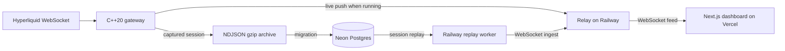

# L2 Market Data Gateway

**Live dashboard:** [l2-orderbook-gateway.vercel.app](https://l2-orderbook-gateway.vercel.app/)

A C++20 market-data capture pipeline for Hyperliquid L2 depth and trades, with a WebSocket relay, Neon-backed session replay, and a Next.js dashboard. The public dashboard makes feed mode explicit: it shows whether data is live or replayed and does not relabel one mode as the other.

## Architecture

The gateway can push a running feed to the relay. Captured sessions are also exported, loaded into Neon, and replayed by a Railway worker. The public Railway deployment uses the Neon replay path.



Bybit was used in an earlier version. The current adapter and instrument metadata target Hyperliquid, including builder-dex symbols such as `xyz:CL`.

## Measured latency

The gateway uses serialized `RDTSCP` timestamp reads at receive, parse, queue, book-update, and publish boundaries. It calibrates the host TSC frequency at startup to convert cycle deltas to time. The queue measurement is push-to-pop transit; it excludes time spent waiting for earlier members of a received batch. Samples and their timestamps are exported for replay and inspection.

The dashboard reads rolling per-stage histograms from the relay. The charts use the captured stage timings; they do not estimate gateway latency from browser render time. A host-jitter canary was used in an earlier iteration and later retired, so current gateway metrics describe pipeline stages rather than a separate scheduler-noise estimate.

The latest numeric comparison documented in the engineering history is a short native Windows desktop run with both instruments active:

| Queue transit | p50 | p90 | p99 | Max | Samples over 1 ms |
| --- | ---: | ---: | ---: | ---: | ---: |
| BTC, both instrument processes active | 3.8 µs | 10.7 µs | **28.5 µs** | 29.9 µs | 0 of 383 |

That run lasted two minutes. Treat it as a measured desktop sample, not as a sustained production or cloud guarantee. Earlier runs exposed a core-allocation bug: both instrument processes pinned busy consumers to the same physical core, producing a 15.4 ms p99 queue wait. Runtime core claiming now reserves one physical core per process, places its producer on the SMT sibling, and keeps the consumers from colliding. The comparison reduced p99 to 28.5 µs.

## Dashboard

The dashboard includes:

- An L2 order-book ladder and depth curve.
- A trades tape with exchange timestamps.
- An explicit Live/Replay selector and per-instrument feed status.
- ECharts latency distributions and per-stage breakdowns from rolling relay metrics.

Charts were migrated from uPlot to ECharts as the latency view grew to include a histogram heatmap, percentile overlays, and stage panels. If the selected feed mode is unavailable, the dashboard displays an unavailable/status state. It does not silently fall back to data from the other mode.

## Engineering decisions

- **SPSC ring buffer:** one producer and one consumer exchange fixed-size ticks using acquire/release atomics. Cache-line separation limits false sharing; the hot path does not take a mutex.
- **Memory-mapped capture:** each fixed-size record is copied once into a preallocated mapped region, avoiding a per-tick `write()` and an extra kernel I/O buffer copy. Compression and file export run on a cold-path worker. This is not NIC kernel bypass.
- **Thread affinity with collision checks:** each gateway instance claims one physical core; its producer runs on that core's SMT sibling, while the consumer gets the core. The earlier hard-coded assignments silently put two instrument consumers on one physical core and caused scheduler-quantum-sized queue delays.
- **L2 scope:** the book represents aggregated quantity by price level. It does not reconstruct per-order L3 queue position.
- **Measure the stages that matter:** each stage has its own timestamp boundary. Batch wait is kept distinct from queue transit so time in a received frame is not attributed to the SPSC queue.
- **Honest feed modes:** live and replay records carry mode and capture-time metadata. An unavailable selection shows a status state instead of substituting the other feed.
- **Charts follow the data model:** uPlot was replaced with ECharts for the current histogram, percentile, and stage views. The relay sends rolling aggregates rather than repeatedly sending the full latency history to every viewer.
- **Cost-aware hosting:** the original cloud experiment targeted $0 shared-vCPU hosting. Scheduler contention left a long latency tail even after tuning, so the public demo moved to desktop-captured sessions and replay. The current providers are Vercel, Railway, and Neon; provider billing is not specified in repository config.

The gateway uses a market-data WebSocket API and does not include exchange order entry, a trading strategy, or L3 order-by-order reconstruction.

## Local development

### Relay and dashboard

Install Node.js and npm, then start the relay and a sample feed:

```bash
cd relay
npm install
npm run dev
```

In a second terminal, from `relay/`, run the fake gateway:

```bash
npm run fake-gateway -- --symbol=BTC
```

In another terminal, configure the dashboard to use the local relay and start Next.js:

```bash
cd web
npm install
# Copy .env.example to .env.local; its default relay URL is http://localhost:8080.
npm run dev
```

Open `http://localhost:3000`. The fake gateway supplies protocol-shaped sample data; it is not an exchange connection. To capture from Hyperliquid, build and run the C++ gateway with the required Boost, simdjson, OpenSSL, and zlib development packages. `CMakeLists.txt` sets C++20 and defines the `L2DataCapture` target.

### Replay from Neon

The relay package includes scripts to create the schema, migrate an exported `.ndjson.gz` session, and replay a stored session. Set `DATABASE_URL` in your local environment, then use `relay/scripts/schema.sql`, `migrate-to-neon.mjs`, and `replay-gateway-neon.mjs` as documented in [relay/README.md](relay/README.md#neon-tick-storage). Keep connection strings and ingest credentials out of Git.

## Deployment

- **Dashboard:** Vercel serves the Next.js app from `project-2-L2-market-data-gateway/web`. Set `NEXT_PUBLIC_RELAY_URL` to the public relay base URL.
- **Relay and replay worker:** `relay/railway.json` defines the Railway build and start commands. `scripts/start-railway.mjs` starts the relay and, when `DATABASE_URL` and `SYMBOLS` are configured, one Neon-backed replay worker per symbol. Set `CORS_ORIGIN` for the dashboard origin and keep `INGEST_TOKEN` private.
- **Tick data:** Neon Postgres stores captured sessions and ordered tick records. The replay worker loads a session at startup, then streams it to the relay at the recorded pace.
- **Live capture:** the C++ gateway can push to `/ingest` using `RELAY_WS_HOST`, `RELAY_WS_PORT`, and TLS settings. The public Railway configuration currently starts the Neon replay workers; it does not run the native C++ capture process.

## Known limitations

- The dashboard's public feed is a replay of captured data from Neon, not a continuously running exchange connection.
- The latency result above is from a short desktop run. It does not characterize a cloud VM or guarantee future sessions.
- Relay rolling latency aggregates are in memory and reset when the relay restarts. Neon stores captured ticks, not the relay's rolling statistics.
- The C++ gateway is designed for L2 feed handling and measurement. It is not a colocated exchange feed handler and does not use DPDK or kernel-bypass networking.

## Repository layout

```text
project-2-L2-market-data-gateway/
├── include/       # C++20 types, SPSC queue, order book, timing, export, relay client
├── src/           # Gateway entry point, Hyperliquid adapter, order book, relay client
├── relay/         # Node.js WebSocket relay, Neon schema and replay/migration scripts
├── web/           # Next.js dashboard and live metrics view
├── scripts/       # Local and hosted gateway helpers
├── CMakeLists.txt
└── README.md
```
