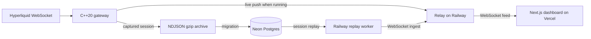

# L2 Market Data Gateway

**Live dashboard:** [l2-orderbook-gateway.vercel.app](https://l2-orderbook-gateway.vercel.app/)

A C++20 market-data capture pipeline for Hyperliquid L2 depth and trades, with a WebSocket relay, Neon-backed session replay, and a Next.js dashboard. The public dashboard makes feed mode explicit: it shows whether data is live or replayed and does not relabel one mode as the other.

## Architecture

The gateway can push a running feed to the relay. Captured sessions are also exported, loaded into Neon, and replayed by a Railway worker. The public Railway deployment uses the Neon replay path.



Bybit was used in an earlier version. The current adapter and instrument metadata target Hyperliquid, including builder-dex symbols such as `xyz:CL`.

## Measured latency

The gateway uses serialized `RDTSCP` timestamp reads at receive, parse, queue, book-update, and publish boundaries. It calibrates the host TSC frequency at startup to convert cycle deltas to time. The queue measurement is push-to-pop transit; it excludes time spent waiting for earlier members of a received batch. Samples and their timestamps are exported for replay and inspection.

The dashboard reads rolling per-stage histograms from the relay. The charts use the captured stage timings; they do not estimate gateway latency from browser render time. A host-jitter canary was used in an earlier iteration and later retired, so current gateway metrics describe pipeline stages rather than a separate scheduler-noise estimate.

The latest numeric comparison documented in the engineering history is a short native Windows desktop run with both instruments active:

| Queue transit | p50 | p90 | p99 | Max | Samples over 1 ms |
| --- | ---: | ---: | ---: | ---: | ---: |
| BTC, both instrument processes active | 3.8 µs | 10.7 µs | **28.5 µs** | 29.9 µs | 0 of 383 |

That run lasted two minutes and predates the consumer-stall fix described under [Engineering decisions](#engineering-decisions). Earlier runs exposed a core-allocation bug: both instrument processes pinned busy consumers to the same physical core, producing a 15.4 ms p99 queue wait. Runtime core claiming now reserves one physical core per process, places its producer on the SMT sibling, and keeps the consumers from colliding. The comparison reduced p99 to 28.5 µs.

After the stall fix, a one-hour capture (12 Oct 2026, 03:35–04:35 IST, native Windows desktop, both instruments running) measured the full gateway pipeline, parse start to publish:

| Parse → publish, one hour | Samples | p50 | p99 | p99.9 | Max |
| --- | ---: | ---: | ---: | ---: | ---: |
| BTC | 5,850 | 4.8 µs | 43.4 µs | 60.0 µs | **63.2 µs** |
| WTI (`xyz:CL`) | 5,738 | 4.5 µs | 30.7 µs | 339.1 µs | **390.3 µs** |

This is the session the public dashboard replays. It was chosen as the most recent hour with no latency spike over 0.5 ms and no feed gap over 11 s, and it was verified against the exchange's own trade timestamps: 3,599 s of exchange time equals 3,599 s of CPU-counter time, so the machine did not sleep during it. It is a desktop measurement, not a cloud or colocated guarantee.

## Dashboard

The dashboard includes:

- An L2 order-book ladder and depth curve.
- A trades tape with exchange timestamps.
- An explicit Live/Replay selector and per-instrument feed status.
- A replay notice with the original capture time, kept distinct from exchange event time and the viewer's clock.
- ECharts latency distributions and per-stage breakdowns from rolling relay metrics.
- A top-bar state badge (`LIVE`, `REPLAY` or `OFFLINE`) taken from the relay's handshake, not from the viewer's selection, plus a labelled local clock.

A tab that has been in the background for 60 s closes its stream and reconnects when it becomes visible again. See [Hosting cost and scale](#hosting-cost-and-scale).

Charts were migrated from uPlot to ECharts as the latency view grew to include a histogram heatmap, percentile overlays, and stage panels. If the selected feed mode is unavailable, the dashboard displays an unavailable/status state. It does not silently fall back to data from the other mode.

## Engineering decisions

- **SPSC ring buffer:** one producer and one consumer exchange fixed-size ticks using acquire/release atomics. Cache-line separation limits false sharing; the hot path does not take a mutex.
- **Memory-mapped capture:** each fixed-size record is copied once into a preallocated mapped region, avoiding a per-tick `write()` and an extra kernel I/O buffer copy. Compression and file export run on a cold-path worker. This is not NIC kernel bypass.
- **Thread affinity with collision checks:** each gateway instance claims one physical core; its producer runs on that core's SMT sibling, while the consumer gets the core. The earlier hard-coded assignments silently put two instrument consumers on one physical core and caused scheduler-quantum-sized queue delays.
- **L2 scope:** the book represents aggregated quantity by price level. It does not reconstruct per-order L3 queue position.
- **Measure the stages that matter:** each stage has its own timestamp boundary. Batch wait is kept distinct from queue transit so time in a received frame is not attributed to the SPSC queue.
- **Honest feed modes:** live and replay records carry mode and capture-time metadata. An unavailable selection shows a status state instead of substituting the other feed.
- **Charts follow the data model:** uPlot was replaced with ECharts for the current histogram, percentile, and stage views. The relay sends a viewer its latency history once, on connect, then only the 10-second bucket that changed.
- **Diagnose before changing hosts:** on the original $0 shared-vCPU cloud instance, queue p99 improved from 45.16 ms to 0.158 ms after scoped real-time scheduling and disabling nonessential timers. A residual tail still reached 10–52 ms in 4 of 829 samples, so the public feed moved to desktop capture and replay instead of presenting shared-vCPU performance as a live latency claim.
- **Sleeps that don't sleep:** with MinGW-w64, `std::this_thread::sleep_for` rounds anything under 1 ms down to zero (measured: 100 µs and 500 µs both return in 0 µs). The export worker's "sleep 500 µs when idle" was therefore a busy-spin at time-critical priority. Each gateway kept its background threads off only its own hot cores, so one instrument's spinning exporter could share the other's consumer core and take it for a full scheduler quantum: 13 queue samples at 32.07–32.15 ms, none between 1 ms and 30 ms. Idle waits now use a high-resolution waitable timer (~1 ms). Each gateway dropped from 2.00 to 1.00 CPU cores, and the one-hour capture above has no sample over 0.4 ms.
- **Keep connections honest:** Hyperliquid closes a connection that has had no traffic for 60 s. The adapter now pings every 30 s and reconnects after 75 s of silence. Trades Hyperliquid re-sends on resubscribe are de-duplicated by time and trade id.
- **Audit against the source:** `relay/scripts/audit-feed.mjs` subscribes to Hyperliquid and to the relay at the same time and matches every trade by id (missing, extra, duplicate, mismatched). It found the relay-side loss described in the [incident review](#incident-review-a-1533-egress-bill).

The gateway uses a market-data WebSocket API and does not include exchange order entry, a trading strategy, or L3 order-by-order reconstruction.

## Local development

### Relay and dashboard

Install Node.js and npm, then start the relay and a sample feed:

```bash
cd relay
npm install
npm run dev
```

In a second terminal, from `relay/`, run the fake gateway:

```bash
npm run fake-gateway -- --symbol=BTC
```

In another terminal, configure the dashboard to use the local relay and start Next.js:

```bash
cd web
npm install
# Copy .env.example to .env.local; its default relay URL is http://localhost:8080.
npm run dev
```

Open `http://localhost:3000`. The fake gateway supplies protocol-shaped sample data; it is not an exchange connection. To capture from Hyperliquid, build and run the C++ gateway with the required Boost, simdjson, OpenSSL, and zlib development packages. `CMakeLists.txt` sets C++20 and defines the `L2DataCapture` target. `relay/scripts/audit-feed.mjs` can compare relay output with the selected Hyperliquid feed.

### Replay from Neon

The relay package includes scripts to create the schema, migrate an exported `.ndjson.gz` session, and replay a stored session; see [relay/README.md](relay/README.md#neon-tick-storage). Keep connection strings and ingest credentials out of Git.

To refresh what the public dashboard replays:

1. Capture with the gateway, then cut a clean one-hour window from the export (no gaps, no spikes; check the CPU counter against exchange trade time, because a desktop that sleeps stops the counter). Shorter sessions also cost less memory on the host; see [Hosting cost and scale](#hosting-cost-and-scale).
2. Store the Neon connection string encrypted, once:
   ```bash
   bash scripts/secrets-lock.sh deploy/neon.env   # writes deploy/neon.env.enc, verifies it, offers to delete the plaintext
   ```
   AES-256-CBC with a PBKDF2-SHA256 key (600,000 iterations) via OpenSSL, which ships with Git for Windows. The passphrase is read without echo and passed on stdin, never on a command line.
3. Upload, replacing each symbol's previous session in the same transaction:
   ```bash
   bash scripts/neon-upload.sh --cpu-ghz=3.80001 \
     BTC=data/replay-upload/BTC/session_<epoch_ms>.ndjson.gz \
     xyz:CL=data/replay-upload/xyz_CL/session_<epoch_ms>.ndjson.gz
   ```
   The script decrypts the connection string into memory, hands it to each migration through its environment, and never prints or writes it.
4. Restart or redeploy the Railway relay. Replay workers load their session at startup.

## Deployment

- **Dashboard:** Vercel serves the Next.js app from `project-2-L2-market-data-gateway/web`. Set `NEXT_PUBLIC_RELAY_URL` to the public relay base URL.
- **Relay and replay worker:** `relay/railway.json` defines the Railway build and start commands. `scripts/start-railway.mjs` starts the relay and, when `DATABASE_URL` and `SYMBOLS` are configured, one Neon-backed replay worker per symbol. Set `CORS_ORIGIN` for the dashboard origin and keep `INGEST_TOKEN` private.
- **Tick data:** Neon Postgres stores captured sessions and ordered tick records. The replay worker loads a session at startup, then streams it to the relay at the recorded pace.
- **Live capture:** the C++ gateway can push to `/ingest` using `RELAY_WS_HOST`, `RELAY_WS_PORT`, and TLS settings. The public Railway configuration currently starts the Neon replay workers; it does not run the native C++ capture process.

## Hosting cost and scale

Railway bills RAM at $10 per GB-month, CPU at $20 per vCPU-month and network egress at $0.05 per GB. The Hobby plan includes $5 of usage a month. Measured costs for this service:

| Item | Measured | Monthly cost |
| --- | --- | ---: |
| Relay + two replay workers, nobody connected | ~222 MB RAM, 0.002 vCPU | ~$2.20 |
| Latency history, full hour, both instruments | ~3 MB | ~$0.03 |
| One viewer, on the wire | BTC 0.56 KB/s, WTI 0.47 KB/s (~2 MB per viewer-hour) | ~$0.07 if watched 24/7 |

Replay-worker memory scales with session length: the earlier 8-hour BTC session needed 144 MB for its worker; the current one-hour session needs 77 MB.

Load test against a local build of the relay (both instruments replaying, viewers split evenly, 45 s per level):

| Viewers | Missed trade deliveries | Same trade, first vs last viewer (p50 / max) | Relay CPU | Relay RAM |
| ---: | ---: | --- | ---: | ---: |
| 100 | 0 | 2.0 / 4.3 ms | 0.034 vCPU | 78 MB |
| 300 | 0 | 5.6 / 9.8 ms | 0.099 vCPU | 97 MB |
| 500 | 0 | 9.9 / 27.8 ms | 0.154 vCPU | 138 MB |

This needed one fix first. Every connecting viewer is sent the retained latency history, and the relay used to rebuild that history from dense histograms on each connection, on Node's single thread:

| Full hour of history, two instruments | Before | After |
| --- | ---: | ---: |
| Preparing one new viewer's history | 141.6 ms | 0.3 ms |
| 300 viewers connecting back to back | ~42 s with no data sent to anyone | 77 ms |
| Memory held for the history | 61.1 MB | ~2.7 MB |

A finished 10-second bucket can never change, so it is now serialized once and its arrays are freed; only the current bucket keeps full histograms, and a connecting viewer's history is assembled from the cached pieces.

The test client ran on the same machine and read all sockets from one process, so the spreads include its own delay. CPU and memory grow linearly, at about 0.03 vCPU and 15 MB per 100 viewers. The relay accepts 500 concurrent viewers by default (`MAX_CLIENTS`).

At that scale the binding constraint is money, not capacity: 500 viewers watching all day is ~24 GB/day, about $1.19/day in egress. `EGRESS_BUDGET_MB_PER_DAY` (default 1024) caps it. The relay counts the bytes actually written to viewer sockets, after compression, once a second. When the day's budget is spent it disconnects viewers with close code 1013 and refuses new ones until 00:00 UTC. Raise the budget deliberately if you expect a traffic spike.

## Incident review: a $15.33 egress bill

**What happened.** After the relay went to Railway, the project ran up $15.33 of usage in about a day. That pushed the account past its $16 hard limit, and Railway took every workload in the account offline, including unrelated projects. Railway's breakdown: network egress 302.48 GB = $15.12, memory $0.17, CPU $0.04. The program was correct in every functional sense: the bill came from how much data it sent.

**The chain from code to bill.**

1. The relay kept an hour of latency history per instrument: 360 ten-second buckets × 6 stages, each a histogram of 1,854 bins.
2. Once a second it serialized **all** of it to JSON, with each histogram as a full 1,854-number array that was almost entirely zeros, and sent it to **every** connected viewer. One message was 8,245,691 bytes.
3. One viewer therefore cost 8.2 MB/s ≈ 29.7 GB per hour ≈ **$1.48 per hour** at $0.05/GB. The $15.12 of egress is about 10 viewer-hours.
4. The viewers were ordinary open dashboard tabs: the production site, local development tabs pointed at the hosted relay, and test runs. A browser keeps a background tab's WebSocket open, so a tab left open overnight kept paying.
5. The visible symptom was missing data, not cost. Viewers could not drain 8.2 MB/s, so the relay's slow-client guard dropped their trades and book updates. A feed audit found only 48 of 457 BTC trades delivered, which is how the 8.2 MB message was found and fixed. Most of the bill had already accrued by then.

**Why nothing caught it.**

- **Local development hides bandwidth.** Localhost traffic is free and effectively unlimited, so an 8 MB/s stream to a local tab looked like nothing.
- **The message grew with uptime.** The history fills over an hour. A freshly started relay sends small messages, so short tests never saw the full size.
- **No byte-level metric.** Nothing measured bytes per viewer. The first cost signal was the provider's usage page.
- **No ceiling inside the application.** The provider's hard limit was the only brake, and it stopped everything in the account, not just the faulty service.
- **The finding was framed as a correctness bug.** When the 8.2 MB message was found, it was treated as the cause of lost trades. Nobody asked what it was costing per hour while it ran.

**What fixed it** (bytes per viewer measured on the wire, replaying the same recorded hour):

| Change | BTC viewer |
| --- | ---: |
| Original: full history every second | 8,052 KB/s |
| History sent once on connect, then only the changed bucket; histograms sent as non-empty bins only | 3.82 KB/s |
| WebSocket compression; per-tick samples kept inside the relay (the dashboard only read one counter from them); unused histograms dropped | **0.56 KB/s** |

Around that: a daily egress budget counted from real socket bytes, and background tabs closing their stream after 60 s. A later review found the same design flaw on the CPU side. Building one viewer's history took 141.6 ms, so 300 viewers connecting at once would have frozen the feed for about 42 s. Finished buckets are now kept as compact JSON, built once and reused: 0.3 ms per viewer, and history memory went from 61 MB to about 3 MB.

**Rules this produced.**

1. **Price every byte before deploying.** Work out bytes per viewer per second × viewers × $/GB, per hour and per month. If you can't state the number, don't deploy the stream.
2. **Measure on the wire, at steady state.** Measure after every retention window has filled, not right after startup.
3. **On a timer, send changes, not state.** Send full state once, when a client connects.
4. **Don't send what no client reads.** Check every message type and field against the code that consumes it.
5. **Put a spending ceiling inside the application.** Provider limits are a last resort, and they stop everything at once.
6. **Stop streaming to clients nobody is looking at.**
7. **Watch the usage graph daily for the first week of any deployment,** and set an email alert well below the hard limit.
8. **When a bug sits on a metered path, ask what it costs per hour while it's live,** and handle it as an outage.

## Known limitations

- The dashboard's public feed loops a one-hour capture stored in Neon unless a gateway is pushing live. A live push takes priority over the replay, and the replay resumes when the live feed stops.
- The latency results above are desktop measurements. They do not characterize a cloud VM or guarantee future sessions.
- A desktop capture stops while the machine sleeps, and the CPU counter used for timestamps stops with it. Exported sessions can contain such gaps; check exchange time against counter time before using a window.
- Relay rolling latency aggregates are in memory and reset when the relay restarts. Neon stores captured ticks, not the relay's rolling statistics.
- The C++ gateway is designed for L2 feed handling and measurement. It is not a colocated exchange feed handler and does not use DPDK or kernel-bypass networking.

## Repository layout

```text
project-2-L2-market-data-gateway/
├── include/       # C++20 types, SPSC queue, order book, timing, export, relay client
├── src/           # Gateway entry point, Hyperliquid adapter, order book, relay client
├── relay/         # Node.js WebSocket relay, Neon schema and replay/migration scripts
├── web/           # Next.js dashboard and live metrics view
├── scripts/       # Local and hosted gateway helpers, secrets encryption, Neon upload
├── CMakeLists.txt
└── README.md
```
